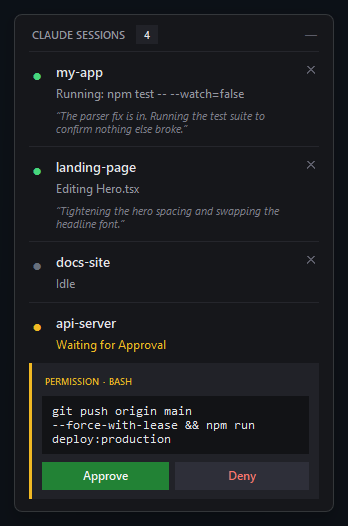
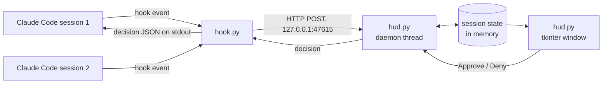
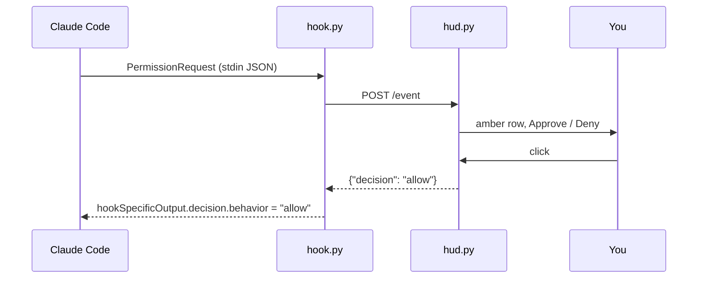

# session-hud

A small always-on-top window for Windows that shows every Claude Code session
running on your machine, what each one is doing right now, and lets you approve
or deny permission requests without switching to the terminal.

It is a Claude Code skill: one folder, Python standard library only, no build step.

<p align="center"></p>

## Contents

- [What you get](#what-you-get)
- [Requirements](#requirements)
- [Install](#install)
- [Daily use](#daily-use)
- [Reading the window](#reading-the-window)
- [Approving and denying](#approving-and-denying)
- [Commands](#commands)
- [How it works](#how-it-works)
- [What the hooks change in settings.json](#what-the-hooks-change-in-settingsjson)
- [When things go wrong: the fail-safe rules](#when-things-go-wrong-the-fail-safe-rules)
- [Security](#security)
- [Privacy](#privacy)
- [Configuration](#configuration)
- [Local HTTP API](#local-http-api)
- [Testing](#testing)
- [Troubleshooting](#troubleshooting)
- [Uninstall](#uninstall)
- [Limitations](#limitations)
- [FAQ](#faq)
- [Project layout](#project-layout)
- [Contributing](#contributing)
- [License](#license)

## What you get

- **One row per session**, across every terminal, VS Code window and project.
- **A status dot**: green while working, amber when it needs your approval, gray when idle.
- **What the AI is doing**, in plain words: `Running: npm test`, `Editing Hero.tsx`,
  `Searching for TODO`, `Thinking`, plus Claude's latest message in that turn.
- **Approve / Deny buttons** with the exact command, right in the window. The click
  unblocks the session at once.
- **Remove** a session you do not want to see with the `✕` on its row.
- **Collapse** to a tiny pill; it opens by itself when an approval arrives.
- **Never in the way**: if the HUD is closed or broken, Claude Code behaves exactly
  as it does without it.

## Requirements

| Need | Notes |
|---|---|
| Windows 10 or 11 | Rounded corners need Windows 11. macOS and Linux are not supported (see [Limitations](#limitations)). |
| Python 3.9+ with tkinter | The standard python.org installer includes tkinter. No pip packages. |
| Claude Code with the `PermissionRequest` hook event | Built and tested against 2.1.325. |

Check Python with:

```powershell
python -c "import tkinter; print('ok')"
```

## Install

1. Clone into your personal skills folder:

   ```powershell
   git clone https://github.com/David-Costache/session-hud "$HOME\.claude\skills\session-hud"
   ```

2. Register the hooks (this backs up `settings.json` first):

   ```powershell
   python "$HOME\.claude\skills\session-hud\scripts\ctl.py" install
   ```

3. Start the window:

   ```powershell
   python "$HOME\.claude\skills\session-hud\scripts\ctl.py" start
   ```

4. **Restart any Claude Code sessions that were already open.** Hooks are loaded
   when a session starts, so older sessions do not report until restarted.

You can also just ask Claude: "start the session HUD". The skill's `SKILL.md`
tells it which command to run.

## Daily use

- Run `ctl.py start` when you want the window. It does not start at login.
- Drag it by the title bar (or by the pill when collapsed).
- Click `—` to collapse it to a pill showing the session count and overall colour.
  Click the pill to expand.
- Click `✕` on a row to remove that session from view.
- Run `ctl.py stop` to close it. Sessions carry on unaffected.

## Reading the window

Each row has up to three lines:

1. **Folder name** of the session's working directory.
2. **Current activity**, built from the tool call in progress:

   | Tool | Shown as |
   |---|---|
   | Bash, PowerShell | `Running: <command>` |
   | Edit, MultiEdit, NotebookEdit | `Editing <file>` |
   | Write | `Writing <file>` |
   | Read | `Reading <file>` |
   | Grep, Glob | `Searching for <pattern>` |
   | WebFetch | `Fetching <url>` |
   | WebSearch | `Searching the web: <query>` |
   | Agent, Task | `Delegating: <description>` |
   | Skill | `Using skill <name>` |
   | MCP tools | `Calling <server>: <tool>` |
   | anything else | `Running: <tool> <main input>` |

   Between tool calls the line reads `Thinking`. When the turn ends it reads `Idle`.
3. **Claude's latest message** in the current turn, in quotes, shown only while the
   session is working. It is read from the tail of the session transcript each time
   a tool starts or finishes.

Status and colour:

| Status | Dot | Set by |
|---|---|---|
| Thinking | green | you sent a prompt, or a tool just finished |
| Running Tool | green | a tool call started |
| Waiting for Approval | amber | a permission request is open |
| Idle | gray | the turn ended, or the session just started |

Ageing:

- Idle for 5 minutes: the row is dimmed.
- Idle for 30 minutes, or the session ends: the row is removed.

Removing a row with `✕` hides the session until it ends. If a hidden session asks
for permission it comes back, so a session can never sit blocked out of sight. Rows
with an open approval have no `✕`. Hidden sessions are forgotten when the HUD restarts.

## Approving and denying

When Claude Code is about to ask for permission, the row turns amber and a card
appears with the tool name, the command or main input, and two buttons.

- **Approve** lets that one tool call run. It does not add a permanent allow rule.
- **Deny** blocks it and tells Claude "Denied from the session HUD".
- Claude Code's own deny and ask rules are still evaluated after an Approve, so
  the HUD cannot override a rule that forbids something.
- If you do not click within 120 seconds, the request falls back to the normal
  prompt in the terminal and the row reads "Answer in the terminal".
- While the HUD is waiting for your click, the terminal prompt may not appear.
  Stop the HUD if you would rather answer in the terminal.
- The window opens by itself if it was collapsed.

## Commands

All commands are subcommands of `scripts/ctl.py`:

| Command | What it does |
|---|---|
| `ctl.py start` | Starts the HUD in the background. Does nothing if it is already running. |
| `ctl.py stop` | Closes the HUD. Waiting approvals fall back to the terminal prompt. |
| `ctl.py status` | Says whether it is running and lists the visible sessions. |
| `ctl.py install` | Adds the hooks to `~/.claude/settings.json`. Safe to run twice. |
| `ctl.py uninstall` | Removes only this project's hooks. |
| `selftest.py` | Simulated end-to-end test. Needs the HUD running. |
| `selftest.py down` | Fail-safe test. Needs the HUD stopped. |

## How it works



There are two moving parts:

- **`hud.py`** is one process. A background thread runs an HTTP server bound to
  `127.0.0.1` only; the main thread runs the tkinter window. Session state lives
  in memory and is lost when the HUD stops. A second copy exits at once because
  the port is taken.
- **`hook.py`** is what Claude Code runs for each hook event. It reads the hook's
  JSON from stdin, posts it unchanged to the daemon, and exits 0.

Hook events used:

| Event | Effect in the HUD | Blocks Claude? |
|---|---|---|
| `SessionStart` | Row appears, Idle | no (async) |
| `UserPromptSubmit` | Thinking | no (async) |
| `PreToolUse` | Running Tool, activity line, latest message | no (async) |
| `PermissionRequest` | Waiting for Approval, card with buttons | **yes**, until click, timeout or fallback |
| `PostToolUse` | Thinking, latest message refreshed | no (async) |
| `Notification` | Idle with the message, or "Answer in the terminal" for permission notices | no (async) |
| `Stop` | Idle | no (async) |
| `SessionEnd` | Row removed | no |

The approval round trip:



The hook prints exactly this for an approval (and `"deny"` with a `message` for a denial):

```json
{"hookSpecificOutput": {"hookEventName": "PermissionRequest", "decision": {"behavior": "allow"}}}
```

## What the hooks change in settings.json

`ctl.py install` appends one entry to each of the eight events above and touches
nothing else. An entry looks like this:

```json
{
  "hooks": [
    {
      "type": "command",
      "command": "C:\\path\\to\\python.exe",
      "args": ["C:\\Users\\you\\.claude\\skills\\session-hud\\scripts\\hook.py"],
      "timeout": 5,
      "async": true
    }
  ]
}
```

- Status hooks are `async` with a 5 second timeout, so they never delay a tool call.
- The `PermissionRequest` hook is not async and has a 150 second timeout.
- Before any change, the file is copied to `settings.json.bak-YYYYMMDD-HHMMSS`.
- If nothing needs to change, nothing is written and no backup is made.
- The interpreter path is the Python that ran `install`. If Python moves, run
  `uninstall` then `install`.
- `uninstall` removes entries whose `args` point into a `session-hud` folder, then
  removes any event list or `hooks` block it left empty.

## When things go wrong: the fail-safe rules

| Situation | What happens |
|---|---|
| HUD not running | Hook cannot connect, gives up after 1 second, exits 0 with no output. Normal prompt. |
| HUD replies with something unexpected | Hook prints nothing, exits 0. Normal prompt. |
| No click within 120 seconds | Daemon answers "no decision". Normal prompt. |
| HUD stopped while an approval is open | The waiting hook is released with no decision. Normal prompt. |
| You answer in the terminal first, or the hook is killed | The daemon notices the closed connection within half a second and clears the card. |
| A new prompt or the end of the turn arrives | Any approval card still shown for that session is cleared. |
| Hook script itself crashes | It still exits 0 with no output. |

The rule behind all of these: **the hook never approves anything by itself.** The
only way a tool call is approved through this project is a click on Approve.

## Security

- The server binds to `127.0.0.1`, so nothing off your machine can reach it.
- Every request must carry a random token in an `X-Token` header. The token is
  created on first use and stored in the `token` file in the skill folder. It is
  compared in constant time, and it is git-ignored.
- The token stops other local programs that cannot read your user files from
  approving on your behalf. A program running as you can read the token; such a
  program could also edit your Claude settings directly, so the HUD does not
  widen that exposure.
- Approve returns a plain allow for one call. It never writes permission rules.
- Traffic is plain HTTP on loopback. It is not encrypted.

## Privacy

- Nothing leaves your machine. There is no telemetry and no network access beyond loopback.
- The HUD holds in memory, for each session: its ID, working directory, the current
  tool input (for example a shell command), and Claude's latest message.
- It reads the last 200 KB of each session's transcript file to find that message.
  It never writes to transcripts.
- The log file records only start, stop and malformed requests, not commands or messages.
- Commands and messages are visible on screen in the window. Collapse or stop it
  when sharing your screen.

## Configuration

There is no config file. Edit the constants and restart the HUD.

| Setting | File | Default |
|---|---|---|
| `PORT` | `scripts/common.py` | `47615` |
| `WAIT` (seconds to wait for a click) | `scripts/hud.py` | `120` |
| `WAIT` (hook-side limit, keep above the daemon's) | `scripts/hook.py` | `130` |
| Hook timeout for `PermissionRequest` (keep above both) | `scripts/ctl.py`, then re-install | `150` |
| `DIM` (idle seconds before dimming) | `scripts/hud.py` | `300` |
| `DROP` (idle seconds before removal) | `scripts/hud.py` | `1800` |
| Colours and fonts | `scripts/hud.py` | dark theme, Segoe UI |
| Window width and opacity | `scripts/hud.py` (`place`, `-alpha`) | 320 px, 0.96 |

The window starts in the bottom-right corner of the primary monitor's work area.
Its position is not remembered between runs.

## Local HTTP API

All requests need the `X-Token` header. Bodies and replies are JSON.

| Method and path | Body | Reply |
|---|---|---|
| `POST /event` | a Claude Code hook payload | `{}`; for `PermissionRequest`, `{"decision": "allow" \| "deny" \| null}` once decided |
| `GET /state` | none | `{"sessions": [{id, cwd, project, status, action, note, idle_s, pending}]}` (visible sessions only) |
| `POST /decide` | `{"id": "<approval id>", "decision": "allow" \| "deny"}` | `{"ok": true \| false}` |
| `POST /dismiss` | `{"id": "<session id>"}` | `{"ok": true}` |
| `POST /quit` | `{}` | `{"ok": true}`, then the HUD exits |

`/decide` and `/dismiss` call the same functions as the buttons, which is how the
self-test exercises them.

## Testing

```powershell
python "$HOME\.claude\skills\session-hud\scripts\selftest.py"        # HUD running
python "$HOME\.claude\skills\session-hud\scripts\selftest.py" down   # HUD stopped
```

The first run drives the real `hook.py` with simulated payloads for a fake session and checks:

- each status change (Idle, Thinking, Running Tool, Thinking, Idle);
- the activity line and Claude's message, using a temporary fake transcript;
- remove hides a session, keeps it hidden while it works, and a permission request brings it back;
- a blocked approval hook is released with the correct allow JSON, then the same for deny;
- a wrong token gets HTTP 403;
- `SessionEnd` removes the session.

The second run checks that with the HUD stopped, the approval hook exits 0 with
no output in under 2 seconds.

What the tests do not cover: real mouse clicks, dragging, collapsing, and how the
window looks. Check those by hand.

## Troubleshooting

| Symptom | Likely cause and fix |
|---|---|
| No window | Run `ctl.py status`. If not running, `ctl.py start`, then read `hud.log`. |
| Window but no sessions | Hooks not installed (`ctl.py install`), or the session was open before install: restart it. |
| A session is missing | You removed it with `✕`, or it has been idle 30 minutes. It returns on a permission request; restart the HUD to unhide everything. |
| "port in use" in `hud.log` | A copy is already running, or another program holds the port. Change `PORT` in `common.py`. |
| Approve seems to do nothing | A deny or ask rule in your Claude settings still applies after an allow. |
| The terminal prompt is slow to appear | The hook is waiting for a HUD click (up to 120 seconds). Click in the HUD, or stop it. |
| No quoted message under a working session | Claude has not written text yet in this turn, or the transcript format changed. The activity line still works. |
| Hooks fail after a Python upgrade | The installed path is stale. `ctl.py uninstall`, then `ctl.py install`. |
| Blurry window | You are on an older Windows without per-process DPI awareness. |
| Text cut off on the right | Long names are clipped by character count, which is approximate. |

The log is `hud.log` in the skill folder.

## Uninstall

```powershell
python "$HOME\.claude\skills\session-hud\scripts\ctl.py" uninstall
python "$HOME\.claude\skills\session-hud\scripts\ctl.py" stop
Remove-Item -Recurse -Force "$HOME\.claude\skills\session-hud"
```

`uninstall` backs up `settings.json` before editing it. Earlier backups stay next
to the file; delete them when you no longer need them.

## Limitations

- **Windows only.** The window uses Win32 calls for the work area, DPI and rounded
  corners, and `ctl.py` relies on `python.exe` / `pythonw.exe` and Windows process flags.
- **Only sessions started after install** report in.
- **State is in memory.** Restarting the HUD empties the list until each session's next event.
- **Thinking has no detail of its own.** Claude Code emits no hook while the model
  is generating, so between tool calls the HUD can only show "Thinking" and the
  last message it found.
- **The quoted message depends on the transcript file format**, which is not a
  documented contract. If it changes, that line disappears and nothing else breaks.
- **Subagent activity** appears under the parent session's row.
- **No keyboard shortcuts**, no sound, no tray icon, no remembered position, no light theme.
- **Primary monitor only** for the starting position.
- **One fixed port.** Two Windows users on the same machine at once would need different ports.
- **Approve is all-or-nothing.** There is no "always allow" option and no editing of the command.

## FAQ

**Does it slow Claude down?**
Status hooks run in the background and take about 50 ms of Python start-up each.
Only the permission hook blocks, and that is the point of it.

**Can it approve something by accident?**
Not without a click on Approve. Every failure path ends in "no decision".

**What if two sessions ask at once?**
Each gets its own card and its own buttons.

**Does it work with the VS Code extension and the terminal CLI?**
It works with anything that reads hooks from `~/.claude/settings.json`.

**Does it work in bypass-permissions or auto-accept modes?**
Sessions still show their activity. Approval cards only appear when Claude Code
would actually ask.

**Why tkinter and not Electron or a web page?**
It ships with Python, starts instantly, and uses a few megabytes.

**Why a TCP port and not a named pipe or Unix socket?**
It is the simplest thing the standard library supports on Windows.

## Project layout

```
session-hud/
├── SKILL.md            what Claude reads to operate the HUD
├── README.md
├── docs/screenshot.png
└── scripts/
    ├── hud.py          daemon + window
    ├── hook.py         the Claude Code hook
    ├── ctl.py          install, uninstall, start, stop, status
    ├── selftest.py     simulated tests
    └── common.py       port, token, HTTP helper
```

Created at runtime and git-ignored: `token`, `hud.log`.

## Contributing

Issues and pull requests are welcome. Please:

- keep it standard-library only;
- keep every hook failure path at "exit 0, no decision";
- run both self-tests before sending a change, and say what you checked by hand.

A macOS or Linux port mainly needs replacements for the Win32 calls in `Hud.__init__`
and for the launcher in `ctl.py`.

## License

No license has been chosen yet. Until one is added, the default copyright rules
apply: you may read the code, but reuse is not granted.
